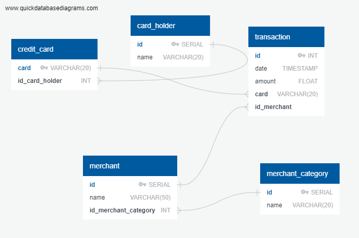
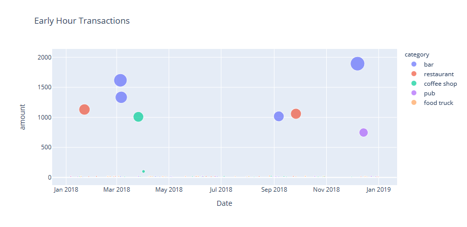
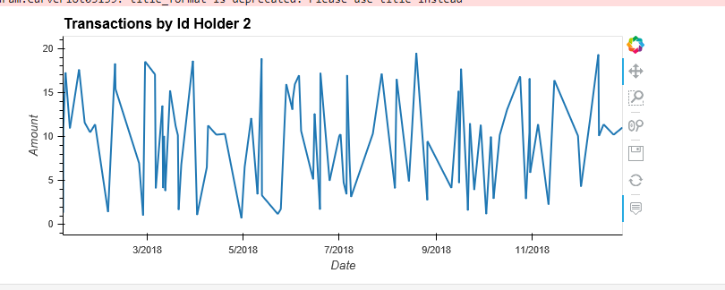
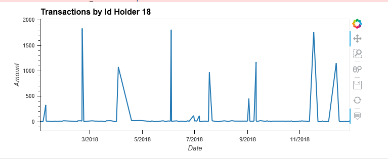
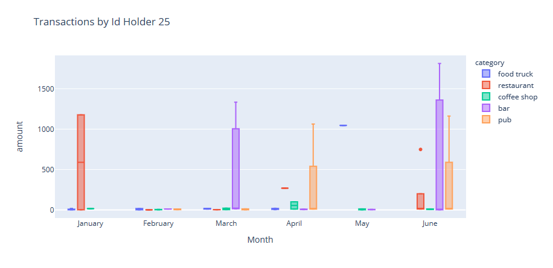
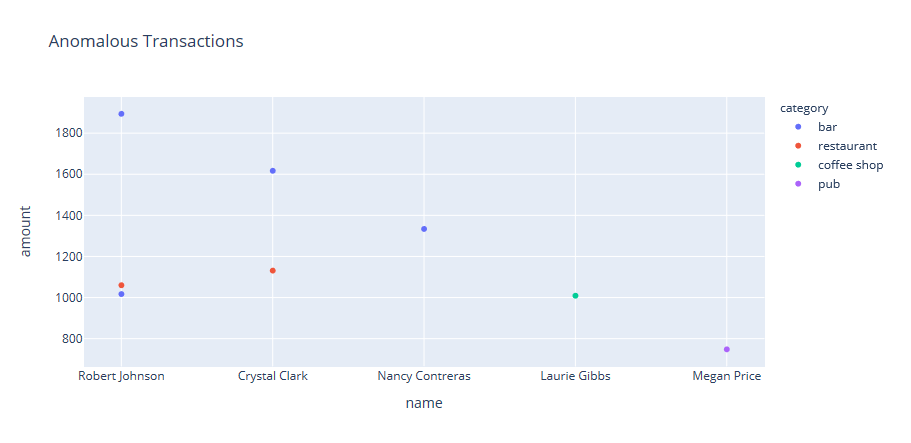
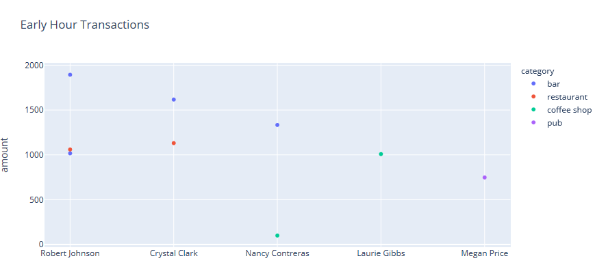

# Credit Card Fraud Detection with SQL & Python


*[Credit Card Fraudster by Richard Patterson](https://www.flickr.com/photos/136770128@N07/42252105582/) | [CC BY 2.0](https://creativecommons.org/licenses/by/2.0/)*

Fraud detection does not always need machine learning. Many real cases are found by strong data analysis that spots abnormal charges. This project models a year of credit-card transactions in **PostgreSQL**, then uses **SQL** and **Python (pandas, Plotly, hvPlot)** to find suspicious activity.

## Highlights

| Question | Finding |
|----------|---------|
| Early-morning (07:00–09:00) charges | 275 of 3,500 transactions; **8 charges between $748 and $1,894** stand far apart from the ordinary ones ($11–$23) |
| Micro-transactions (< $2) | 350 charges (10% of all). Counts follow overall volume (r ≈ 0.88), so the **share per holder** is the better signal; the highest is holder 18 at 14.3% |
| Holders 2 vs 18 | Holder 2 never exceeds $19.51. **Holder 18 has 7 charges over $900** (up to $1,839) and is the one to review |
| Holder 25, Jan–Jun 2018 | **6 charges over $1,000** across bars, pubs, a restaurant and a food truck; 5 of them made between 03:46 and 07:18 |
| Outlier rules | 3σ flags **77** transactions, IQR flags **110**: the 3σ rule is distorted by the very outliers it should catch |

## Tech stack

PostgreSQL 14+ · SQL (joins, window functions, views, `percentile_cont`) · Python 3.10+ · pandas · SQLAlchemy · Plotly Express · hvPlot · Jupyter

## Repository structure

```
Fraud_Detection_SQL/
├── Data/                        # Source CSV files
├── Images/                      # ERD and result screenshots
├── SQL/
│   ├── schema.sql               # Tables, constraints, indexes (re-runnable)
│   ├── seed.sql                 # Loads the data
│   ├── views.sql                # Reusable analysis views
│   └── analysis_queries.sql     # Fraud queries, including outliers in pure SQL
├── notebooks/
│   ├── db_utils.py              # Database connection helper (reads DATABASE_URL)
│   ├── visual_data_analysis.ipynb
│   └── outlier_challenge.ipynb
├── .env.example                 # Connection string template
├── requirements.txt
└── README.md
```

## Getting started

**1. Create the database and load it**

```bash
createdb fraud_detection
psql -d fraud_detection -f SQL/schema.sql
psql -d fraud_detection -f SQL/seed.sql
psql -d fraud_detection -f SQL/views.sql
```

**2. Set up Python**

```bash
python -m venv .venv && source .venv/bin/activate   # Windows: .venv\Scripts\activate
pip install -r requirements.txt
cp .env.example .env     # then edit .env with your own PostgreSQL credentials
jupyter lab notebooks/
```

Credentials are read from the `DATABASE_URL` environment variable, so no password is stored in the code.

## 1. Data modeling

The ERD was designed from the CSV files with [Quick Database Diagrams](https://app.quickdatabasediagrams.com/#/).



| Table | Purpose |
|-------|---------|
| `card_holder` | 25 customers |
| `credit_card` | 53 cards, each belonging to one holder |
| `merchant_category` | 5 categories: restaurant, coffee shop, bar, pub, food truck |
| `merchant` | 150 merchants, each in one category |
| `transaction` | 3,500 transactions from 2018-01-01 to 2018-12-31 |

Design decisions:

* `credit_card.card` is `VARCHAR(20)`, not `INT`: a card number is an identifier, and some values exceed the `INT` range.
* `transaction.amount` is `NUMERIC(10,2)`, not `FLOAT`, so money carries no floating-point rounding error.
* Foreign keys and indexes cover every join and the `date` filter used by the analysis.

## 2. Data engineering

`schema.sql` can be run repeatedly (it drops and recreates the tables), and `seed.sql` loads the data.

> **Data note:** `Data/credit_card.csv` stores card numbers in scientific notation (for example `3.51711E+15`), which loses digits when opened in a spreadsheet. `SQL/seed.sql` contains the complete numbers and is the authoritative source for loading.

## 3. Data analysis

All queries are in [`SQL/analysis_queries.sql`](SQL/analysis_queries.sql); the reusable ones are views in [`SQL/views.sql`](SQL/views.sql).

| View | Description |
|------|-------------|
| `v_transaction_details` | Every transaction joined with card holder, merchant and category |
| `v_early_hour_top100` | Top 100 transactions between 07:00 and 09:00 |
| `v_small_transactions_by_holder` | Count and share of transactions under $2 per card holder |
| `v_top5_merchants_small_tx` | Top five merchants by number of transactions under $2 |

### Early-hour transactions

The 100 highest transactions between 07:00 and 09:00 contain a sharp break: 91 ordinary charges ($11.65–$23.13) and eight charges of $748–$1,894, spread over bars (4), restaurants (2), a coffee shop (1) and a pub (1). A $1,009 coffee-shop charge at breakfast time looks the most out of place.



### Micro-transactions

Some fraudsters test a stolen card with several payments under $2 that cardholders ignore.

**Is there evidence that a card has been hacked?** Not from raw counts alone. Micro-transactions are 10% of all activity, and the count per holder (3 to 26) rises with the holder's total number of transactions (r ≈ 0.88). Megan Price has the most (26) but they are only 12.2% of her 213 transactions. By share, **Malik Carlson (14.3%)**, Gary Jacobs (13.8%) and Stephanie Dalton (13.3%) stand out most, though the spread (4.7%–14.3%) is modest. A micro-transaction pattern is a lead for review, not proof.

**Top five merchants by micro-transactions** (several merchants tie at 5; ties are broken by distinct cards, then name):

| Rank | Merchant | Category | Micro-transactions |
|------|----------|----------|--------------------|
| 1 | Wood-Ramirez | bar | 7 |
| 2 | Baker Inc | food truck | 6 |
| 3 | Hood-Phillips | bar | 6 |
| 4 | Atkinson Ltd | bar | 5 |
| 5 | Clark and Sons | food truck | 5 |

Bars appear most often, which makes the category worth monitoring.

### Card holders 2 and 18

| Holder | Transactions | Median | Average | Largest | Charges over $100 |
|--------|-------------|--------|---------|---------|-------------------|
| 2 (Shane Shaffer) | 99 | $10.26 | $9.59 | $19.51 | 0 |
| 18 (Malik Carlson) | 133 | $10.37 | $90.98 | $1,839 | 12 |




Both holders spend about $10 on a typical day. **Holder 2's pattern is stable.** **Holder 18's is not:** seven charges over $900 occur at restaurants, a pub and a food truck, some at odd hours (03:23, 05:30). Holder 18 also has the highest share of micro-transactions (14.3%), so this account deserves the first review.

### Card holder 25: first half of 2018

The CEO suspects unauthorised use of her corporate card for expensive restaurant bills between January and June 2018. One box plot per month shows the outliers.



Charges outside the normal range appear in five of six months (none in February). Six exceed **$1,000**: $1,813 (bar), $1,334 (bar), $1,177 (restaurant), $1,162 (pub), $1,063 (pub) and $1,046 (food truck). Five of those six were made between 03:46 and 07:18, hours when ordinary meals are unusual. The suspicious activity is therefore **not limited to restaurants**; her typical charge is $10–$15.

## Challenge: statistical outlier detection

Two classic rules applied to every transaction ([`outlier_challenge.ipynb`](notebooks/outlier_challenge.ipynb)):

| Rule | Upper cut-off | Flagged (all day) | Flagged 07:00–09:00 |
|------|--------------|-------------------|---------------------|
| Mean + 3 standard deviations | $646.83 | 77 | 8 |
| Q3 + 1.5 × IQR | $31.02 | 110 | 9 |

**Standard deviation (3σ):**



**Interquartile range (IQR):**



Key points:

* The few very large charges inflate the mean and standard deviation, so 3σ misses 33 charges between $57 and $626. IQR is robust to those outliers and catches them.
* The data has a clean gap: no transaction falls between $23.13 and $57, so the extra IQR flags are unusual charges, not normal spending.
* Applying the IQR rule **per card holder** gives the same 110 flags: spending is homogeneous in this dataset (every holder's median is about $10). With real, varied customers a per-customer baseline would matter.
* Most early-morning flagged charges are at **bars**.

## Limitations

* The dataset has no fraud labels, so findings are *suspicious* patterns rather than confirmed fraud, and rule accuracy cannot be measured.
* It covers a single year, 25 holders and five merchant categories.
* There is no location or device data, which production systems rely on.

## Next steps

* Combine amount outliers, a per-customer baseline and time of day into a **risk score**.
* Add features such as transaction velocity (charges per hour) and merchant-level anomaly rates.
* Train a supervised model (for example gradient boosting) if labelled fraud data is available.

## Credits

Dataset and project outline from the data-analytics bootcamp assignment. Header photo by Richard Patterson (CC BY 2.0).
